<div align="center">

# CourseReg · Concurrency-Safe Real-Time Course Registration

**A Go + PostgreSQL registration service with a live React dashboard, plus a controlled experiment that measures what it costs to stop overselling seats.**


[**Research report (PDF)**](docs/research-report.pdf) ·
[Methodology](docs/methodology.md) ·
[Architecture](docs/system-architecture.md) ·
[API reference](docs/api-reference.md) ·
[Raw data](experiments/results/2026-10-29/) ·
[Data card](docs/data-card.md) ·
[Cite](CITATION.cff)

**Live demo:** run it locally in one command ([Quick start](#quick-start)). A hosted demo is not deployed yet.

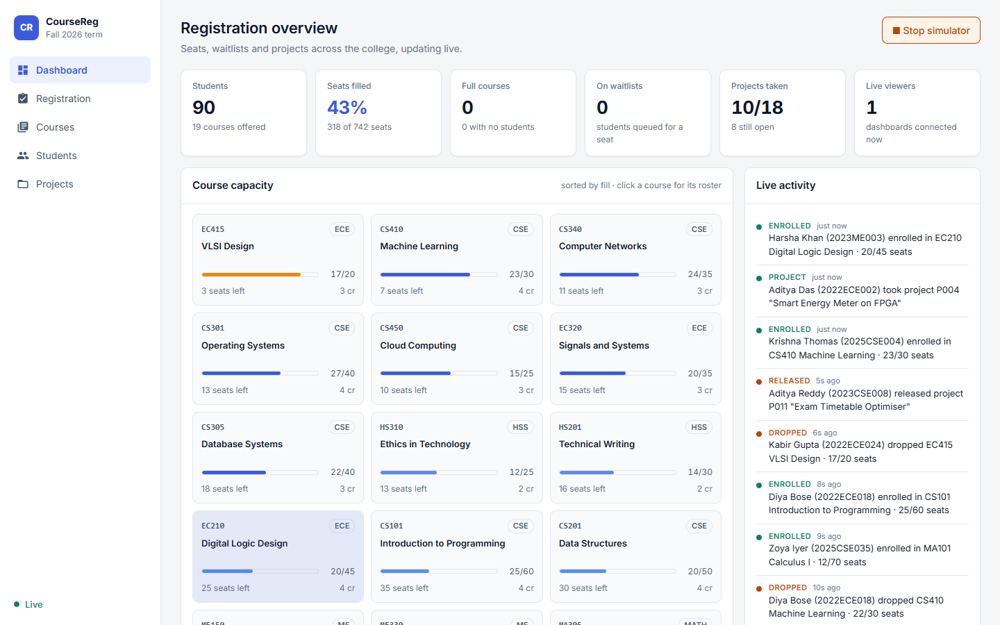

</div>

## Key findings at a glance

| | Baseline | This system | Evidence |
|---|---|---|---|
| **Seat overselling** (5-seat course, 10 to 100 students at once) | oversold in **120 / 120** trials, up to **62** seats | **0 / 120** trials (95% upper bound 2.5%) | Fisher exact, Holm p = 3.4 × 10⁻¹⁷ |
| **Lost project claims** (2 to 20 students claim one project) | every claimant told "you won": **990** phantom winners | exactly **1** winner in 120 / 120 trials | Fisher exact, Holm p = 3.4 × 10⁻¹⁷ |
| **Latency cost of correctness** | 5.6 to 15.9 ms median | 8.9 to 27.2 ms median (**1.6 to 1.7×**) | Mann–Whitney, Cliff's δ 0.77 to 0.96 |
| **Staleness of other viewers' screens** | polling: **161 ms** (500 ms) and **1,626 ms** (2 s) median | SSE: **~4 ms** median, p99 ≤ 8 ms, 100 viewers | 16,900 / 16,900 delivered |

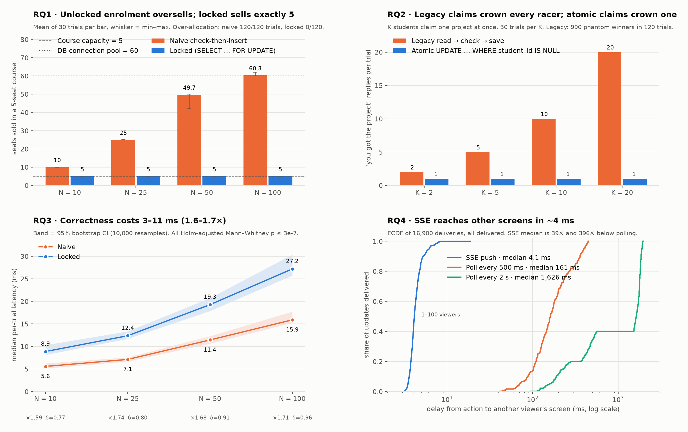

---

## Contents
1. [Project overview](#1-project-overview)
2. [Problem statement](#2-problem-statement)
3. [Research objectives](#3-research-objectives)
4. [Literature review](#4-literature-review)
5. [Proposed methodology](#5-proposed-methodology)
6. [System architecture](#6-system-architecture)
7. [Experimental setup](#7-experimental-setup)
8. [Results](#8-results)
9. [Statistical analysis](#9-statistical-analysis)
10. [Reproducibility](#10-reproducibility)
11. [Limitations](#11-limitations)
12. [Future work](#12-future-work)

[Quick start](#quick-start) · [Repository structure](#repository-structure) · [Citation](#citation)

---

## 1. Project overview

The project began as a Go microservice brief: model **students, courses and projects** in PostgreSQL with GORM, with many-to-many enrolment and a one-to-one project assignment ([original brief](docs/original-brief.pdf)). It was extended into a working college registration portal:

- **Business rules a real registrar needs:** seat capacity, per-student credit limits, FIFO waitlists with automatic promotion, and one final-year project per student.
- **A live dashboard.** Every enrolment, drop, waitlist change or project claim is pushed to every open browser over **Server-Sent Events**.
- **A traffic simulator** that drives realistic random activity through the same rules, so the system can be watched under load.

The research question behind it is **what does correctness under concurrency cost, and does live push beat polling?** It is answered with a pre-registered, randomised, repeated experiment instead of a single demo run.

| Dashboard (dark) | Student registration | Final-year projects |
|---|---|---|
| 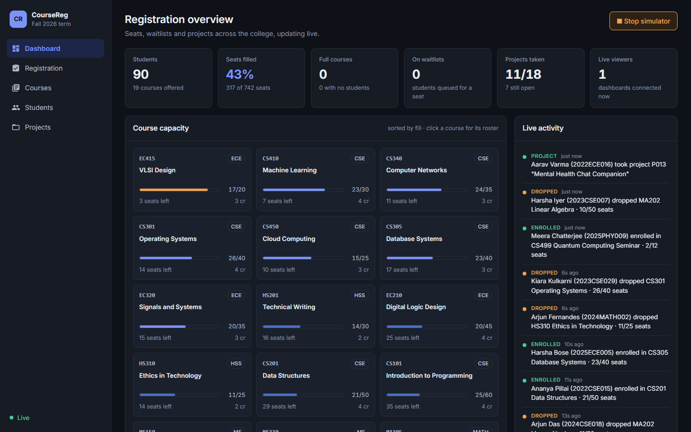 | 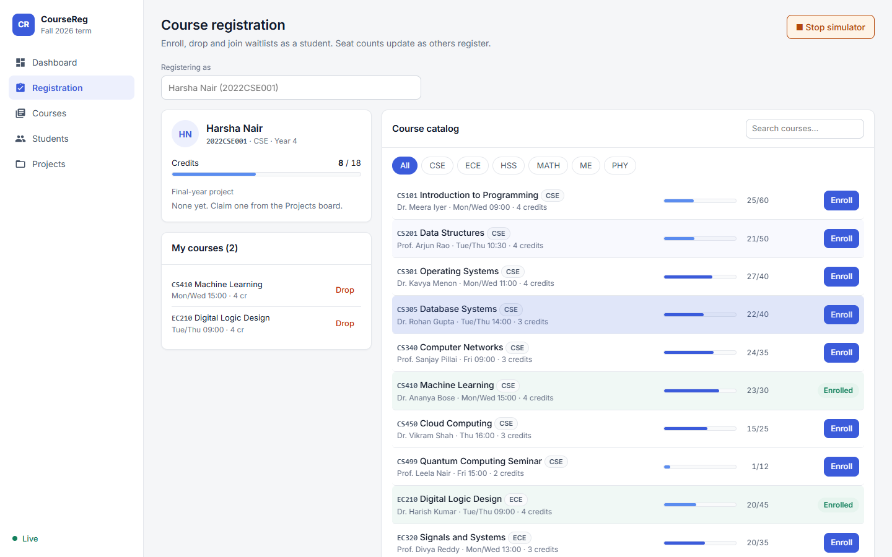 | 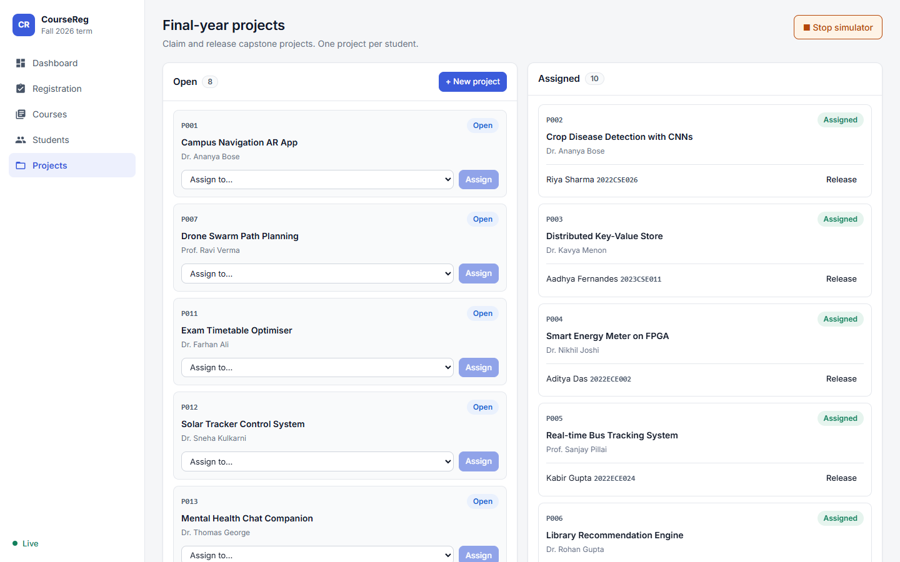 |

## 2. Problem statement

When registration opens, hundreds of students compete for a few seats within seconds. The obvious implementation, *count the enrolled students and insert if there is room*, is a time-of-check/time-of-use race. Under PostgreSQL's default **Read Committed** isolation, concurrent transactions all see the same "room left" and all insert. The failure is **silent**: every student gets `201 Created`, nothing is logged, and the course quietly holds more students than seats. A similar *read → check → save* project claim produces Berenson's **lost update**: several students are told they own the same project.

The second problem is visibility. A registration page that refreshes on a timer shows seats that are already gone. How stale is it, and what does live push cost?

## 3. Research objectives

| RQ | Question | Hypothesis |
|---|---|---|
| **RQ1** | Does row locking stop seat over-allocation? | H1: the naive path oversells more as contention N grows; the locked path never does |
| **RQ2** | Does a conditional `UPDATE` stop lost project claims? | H2: the legacy path reports several winners; the atomic path exactly one |
| **RQ3** | What latency does correctness cost? | H3: locking raises latency, and the effect grows with N |
| **RQ4** | How stale is another viewer's screen? | H4: SSE median delay is below both polling intervals; polling delay ≈ Uniform(0, T) |

All hypotheses, factor levels, sample sizes and tests were fixed **before** data collection.

## 4. Literature review

| Area | Existing approach | Limitation this project addresses |
|---|---|---|
| Isolation anomalies | Berenson et al. (1995) show that ANSI levels miss the lost update; PostgreSQL Read Committed allows it | Rarely *quantified* for a concrete enrolment workload |
| Remedies | Pessimistic `SELECT … FOR UPDATE` in a consistent lock order (PostgreSQL docs); conditional writes; triggers with `CHECK` | Practitioner guidance is mostly informal, with no latency price attached |
| Live updates | SSE (WHATWG HTML §9.2), WebSockets (RFC 6455); Van de Vyvere et al. (ICWE 2020) found SSE beats polling at 25k clients | Throughput-at-scale focus; end-to-end *staleness* with uncertainty is rarely reported |

**Gap:** no single study measures (a) how often naive enrolment oversells as contention grows, (b) the latency price of the fix and (c) SSE vs polling staleness, with repeated trials and confidence intervals, on one system. Full review with 13 references: [docs/literature-review.md](docs/literature-review.md).

## 5. Proposed methodology

**Engineering solution**

| Rule | Mechanism |
|---|---|
| Seat limit and credit limit | One transaction: lock the student row, then the course rows **sorted by id** (`SELECT … FOR UPDATE`), count, then insert. Consistent lock order means no deadlocks. |
| One student per project | Single statement `UPDATE projects SET student_id = ? WHERE id = ? AND student_id IS NULL`. 0 rows affected → `409 project_taken`. |
| One project per student | Partial unique index on `projects.student_id WHERE student_id IS NOT NULL` |
| No duplicate enrolment | Unique index on `student_courses(student_id, course_id)` |
| Waitlist | FIFO by `created_at`; a drop promotes the next eligible student in the same transaction |
| Live updates | After commit, write an `activities` row and publish to an in-process SSE hub that fans out to every browser |

**Scientific method:** each fix is compared against a **baseline that reproduces the unprotected logic**, under identical conditions. See [docs/methodology.md](docs/methodology.md).

| Experiment control | How |
|---|---|
| Independence | Fresh course or project per trial |
| Isolate one rule | 1,000-credit benchmark students and 1-credit courses, so only the seat rule can bind |
| Simultaneous start | All goroutines wait at a barrier and are released together |
| Drift | Arms × levels run in **seeded random order** in every repetition |
| Warm-up | 2 repetitions per cell discarded |
| Fair comparison | Both arms share one 60-connection pool and write the same activity row |

## 6. System architecture

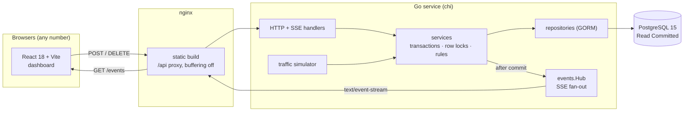

Layers: `handlers → services → repositories → PostgreSQL`, with `events.Hub` beside the service layer. Details, schema and sequence diagrams: [docs/system-architecture.md](docs/system-architecture.md).

## 7. Experimental setup

| | |
|---|---|
| **Design** | 2 arms × 4 levels per RQ, full factorial, 30 measured + 2 warm-up repetitions per cell |
| **Factors** | RQ1/RQ3: N = 10, 25, 50, 100 students, capacity 5 · RQ2: K = 2, 5, 10, 20 claimants · RQ4: SSE S = 1, 10, 50, 100 viewers vs polling T = 500 and 2,000 ms |
| **Volume** | 512 trials, 14,208 request rows, 16,900 delivery rows, 53 resource samples (**31,830 raw rows**) |
| **Seed** | `20261029` (run order and simulated data) |
| **Hardware** | Intel Core i5-12400F (6C/12T), 15.9 GB RAM, Docker 29.9.2 on WSL2 (12 vCPU, 7.7 GiB) |
| **Software** | Go 1.20.14, GORM 1.25.5, pgx 5.3.1, chi 5.0.10, PostgreSQL 15.19, React 18.3.1 |
| **Analysis** | Python 3.14, NumPy 2.5.4, pandas 3.1.0, SciPy 1.18.1, statsmodels 0.15.0, matplotlib 3.11.2 |
| **Data** | Synthetic, generated by the harness ([data card](docs/data-card.md)); the demo dashboard uses a separate random seed college |

## 8. Results

### RQ1: seat over-allocation
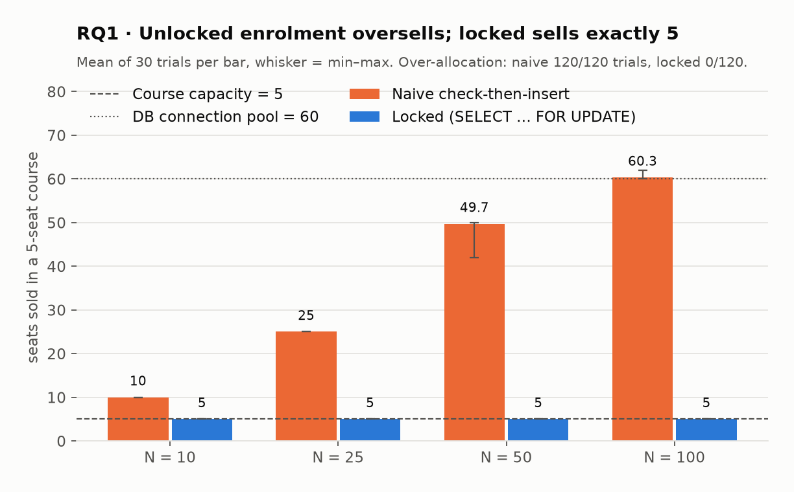

The naive arm admitted *every* student up to N = 25, then plateaued at the **connection-pool size (60)**, not at capacity: seats sold ≈ min(N, pool). It completed 4,352 enrolments where only 600 were allowed, all reported as success. The locked arm sold exactly 5 seats in 120 / 120 trials.

### RQ2: lost project claims
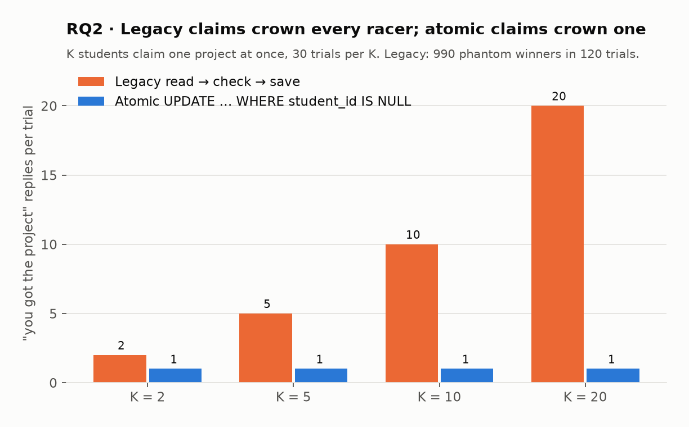

| K | Legacy "assigned" replies | Legacy trials with lost update (95% Wilson CI) | Atomic replies | Atomic lost updates |
|---|---|---|---|---|
| 2 | 2.0 | 30/30 (88.6–100%) | 1.0 | 0/30 |
| 5 | 5.0 | 30/30 (88.6–100%) | 1.0 | 0/30 |
| 10 | 10.0 | 30/30 (88.6–100%) | 1.0 | 0/30 |
| 20 | 20.0 | 30/30 (88.6–100%) | 1.0 | 0/30 |

### RQ3: latency cost of correctness
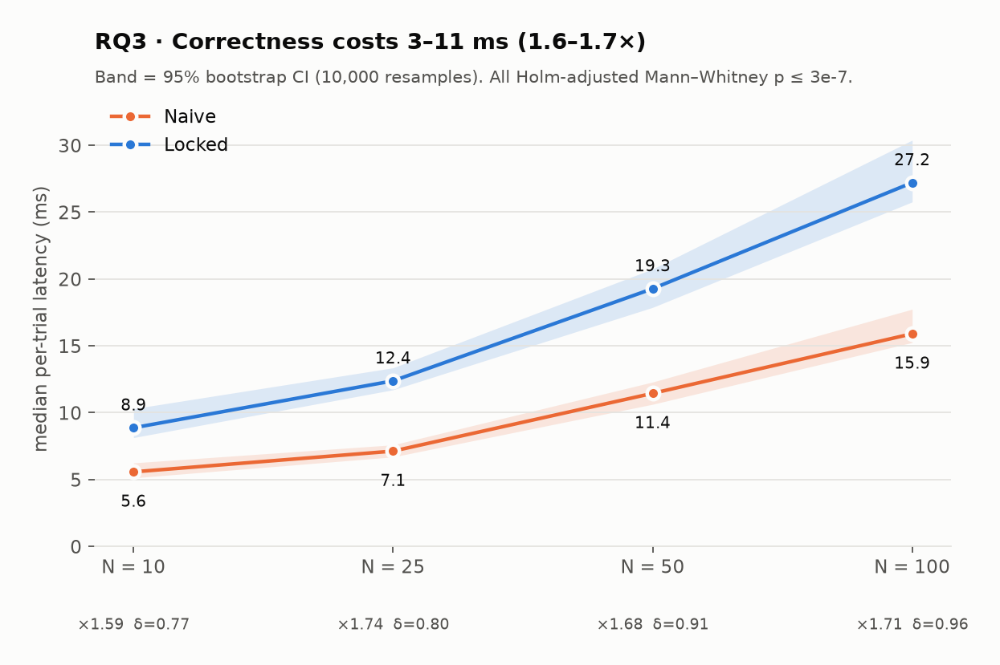

| N | Naive median (95% CI) | Locked median (95% CI) | Ratio (95% CI) | Cliff's δ | Holm p |
|---|---|---|---|---|---|
| 10 | 5.6 (5.1–6.2) ms | 8.9 (8.1–10.3) ms | 1.59 (1.35–1.88) | 0.77 large | 3.0 × 10⁻⁷ |
| 25 | 7.1 (6.7–7.6) ms | 12.4 (11.7–13.4) ms | 1.74 (1.60–1.92) | 0.80 large | 2.0 × 10⁻⁷ |
| 50 | 11.4 (10.6–12.3) ms | 19.3 (17.9–20.7) ms | 1.68 (1.53–1.85) | 0.91 large | 4.6 × 10⁻⁹ |
| 100 | 15.9 (15.2–17.7) ms | 27.2 (25.8–30.4) ms | 1.71 (1.52–1.93) | 0.96 large | 8.6 × 10⁻¹⁰ |

The naive arm stayed faster while writing **7.3× more rows**, so the gap is lock waiting, not extra work.

### RQ4: staleness of other viewers' screens
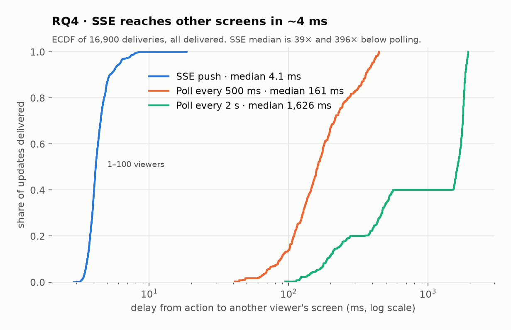

| Mode | Level | Deliveries | p50 (95% CI) | p95 | p99 |
|---|---|---|---|---|---|
| SSE | 1 viewer | 100 | 3.7 (3.6–3.8) ms | 5.2 ms | 7.0 ms |
| SSE | 10 viewers | 1,000 | 4.1 (4.1–4.1) ms | 5.9 ms | 8.0 ms |
| SSE | 50 viewers | 5,000 | 4.0 (4.0–4.1) ms | 5.6 ms | 6.5 ms |
| SSE | 100 viewers | 10,000 | 4.2 (4.2–4.2) ms | 6.3 ms | 7.9 ms |
| Polling | every 500 ms | 400 | 161 (154–172) ms | 398 ms | 440 ms |
| Polling | every 2,000 ms | 400 | 1,626 (1,580–1,680) ms | 1,897 ms | 1,937 ms |

**Resource use:** the Go service peaked at **4.7% CPU / 16.8 MiB** across the whole run; PostgreSQL peaked at 86% CPU during the N = 100 bursts.

### Hypothesis verdicts

| Hypothesis | Verdict | Key evidence |
|---|---|---|
| H1 | ✅ Supported | 120/120 vs 0/120; Spearman ρ = 0.99 between N and seats oversold |
| H2 | ✅ Supported | 120/120 vs 0/120; 990 students wrongly told they won |
| H3 | 🟡 Partly | Absolute cost grows 3.3 → 11.3 ms; *relative* cost flat at 1.6–1.7× (CIs overlap) |
| H4 | 🟡 Partly | SSE 39× and 396× faster; Uniform(0, T) model rejected (KS D = 0.29, 0.36), explained by a design flaw (see §9) |

## 9. Statistical analysis

| Concern | Treatment |
|---|---|
| **Unit of analysis** | One **trial** = one observation (n = 30 per cell), not the 9,300 individual requests, which share rows and are not independent. Avoids pseudo-replication. |
| **Rates** | Wilson 95% intervals; Fisher's exact test between arms |
| **Zero-failure claims** | Exact one-sided bound: 0/120 → true rate < **2.5%** with 95% confidence (rule of three). "Zero observed" is reported as "rarer than 1 in 40", not "impossible". |
| **Latency** | Heavy-tailed, so medians, **10,000-resample bootstrap CIs**, Mann–Whitney U, Cliff's δ (Romano thresholds; \|δ\| ≥ 0.474 = large) instead of means and t-tests |
| **Multiple comparisons** | Holm correction across levels, α = 0.05 |
| **Trend** | Spearman ρ (N vs oversold seats = 0.99; viewers vs SSE delay = 0.15: detectable but negligible) |
| **Model fit** | Kolmogorov–Smirnov against Uniform(0, T) for polling delay |

**Variability across iterations**

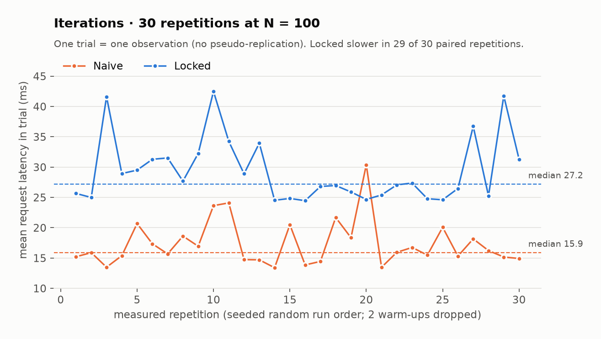

The locked arm was slower in 28, 28, 29 and 29 of 30 paired repetitions at N = 10, 25, 50 and 100. The coefficient of variation at N = 100 was 0.18 (locked) and 0.22 (naive). At most 2 trials per cell exceeded 3× their cell median.

**Threat to validity found in the data.** In RQ4, each poller kept a fixed phase and the next action was timed off the slowest poller, so actions were **phase-locked** to the polling clock. Delay varied little within a poller (SD ≈ 30 ms) but a lot between pollers. The effective sample is 10 phases per interval, not 400. This is why the uniform model fails and why the polling CIs are too narrow. The SSE-vs-polling conclusion survives: the *fastest* polling p5 (70 ms) is still 9× the *slowest* SSE p99 (8 ms).

## 10. Reproducibility

Every number above is regenerated from stored raw data:

```bash
# 1. bring up db + service, keep background traffic off
docker compose up -d --build
curl -X POST localhost:8080/simulator/stop

# 2. run the benchmark harness (writes CSVs + manifest.json)
docker run --rm --network go-student-service-complete_default -e DB_HOST=db \
  -v "$PWD:/app" -w /app golang:1.20-alpine \
  go run ./experiments/bench -out experiments/results/<date>

# 3. statistics + figures
pip install -r experiments/analysis/requirements.txt
python experiments/analysis/analyze.py experiments/results/<date>   # -> summary.json
python figures/make_figures.py experiments/results/<date>           # -> figures/*.png
```

| Evidence | Where |
|---|---|
| Raw CSVs (31,830 rows, unedited) | [`experiments/results/2026-10-29/`](experiments/results/2026-10-29/) |
| Run manifest: versions, CPUs, all parameters, seed, UTC start/end | [`manifest.json`](experiments/results/2026-10-29/manifest.json) |
| Code fingerprint | SHA-256 over all `.go` sources: `ad717c4fa68a…` |
| Every quoted statistic | [`summary.json`](experiments/results/2026-10-29/summary.json) |
| Harness · analysis · figure scripts | [`experiments/bench/main.go`](experiments/bench/main.go) · [`analyze.py`](experiments/analysis/analyze.py) · [`make_figures.py`](figures/make_figures.py) |
| Pinned Python dependencies | [`requirements.txt`](experiments/analysis/requirements.txt) |
| Rerun guide and flags | [`experiments/README.md`](experiments/README.md) |

## 11. Limitations

- **One machine, local network.** Real internet latency and multi-host effects are missing.
- **The pool shaped the plateau.** The naive arm's ~60-seat ceiling is the connection-pool size; a different pool moves it.
- **Synthetic workload.** Identical requests, 1-credit courses, one run date.
- **One isolation level.** Only Read Committed was tested.
- **Scale.** SSE was measured to 100 viewers, not thousands. The hub is in-process, so the service must run as a **single instance**.
- **RQ4 polling design.** Phase-locked actions gave 10 effective samples per interval (§9).
- **No automated unit tests yet.** Correctness is evidenced by the experiment harness, not a `go test` suite.

## 12. Future work

1. Compare row locks against `SERIALIZABLE` + retry and a trigger-maintained counter with a `CHECK` constraint.
2. Scale SSE to thousands of subscribers across several instances, using PostgreSQL `LISTEN/NOTIFY` for fan-out.
3. Redesign RQ4 with Poisson-timed actions so polling samples are independent.
4. Repeat on different hardware with emulated network delay (`tc netem`).
5. Sensitivity analysis on pool size and capacity; ablation of each lock.
6. Add a `go test` suite with a disposable Postgres (testcontainers) and CI.

---

## Quick start

```bash
docker compose up --build
```

| | |
|---|---|
| Dashboard | http://localhost:3000 |
| API | http://localhost:8080 |

The database is seeded with a random demo college: 19 courses, 90 students, 18 projects and ~300 enrolments. Click **Simulate traffic** and open two browser windows to watch them sync. `SEED_DEMO_DATA=false` starts empty; `docker compose down -v` reseeds.

<details>
<summary>Run without Docker</summary>

1. `docker compose up db -d`
2. Export the variables in [`.env.example`](.env.example)
3. `go run ./cmd/service`
4. `cd web && npm install && npm run dev`, then open http://localhost:5173
</details>

Full endpoint list, request bodies and error codes: [docs/api-reference.md](docs/api-reference.md).

## Repository structure

```
├── cmd/service/            entrypoint, graceful shutdown
├── internal/
│   ├── config/             environment configuration
│   ├── db/                 connection, AutoMigrate, FK + partial unique indexes
│   ├── models/             GORM models
│   ├── repositories/       queries, summaries, row locks
│   ├── services/           business rules, transactions, event publishing
│   ├── events/             SSE fan-out hub
│   ├── handlers/           HTTP + SSE handlers
│   ├── seed/               random demo college
│   └── simulator/          demo traffic generator
├── web/                    React + TypeScript dashboard (Vite, nginx)
├── experiments/
│   ├── bench/              benchmark harness (Go): baselines, barrier start, seeded order
│   ├── analysis/           statistics (Python): analyze.py, pinned requirements
│   └── results/2026-10-29/ raw CSVs, manifest.json, summary.json, diagnostic plots
├── figures/                README figures, make_figures.py, screenshots/
├── docs/
│   ├── research-report.pdf
│   ├── literature-review.md
│   ├── methodology.md
│   ├── system-architecture.md
│   ├── api-reference.md
│   ├── data-card.md
│   └── original-brief.pdf
├── migrations/  tests/
├── docker-compose.yml  Dockerfile  .env.example
├── CITATION.cff  LICENSE
```

## Citation

```bibtex
@misc{coursereg2026,
  title  = {Concurrency-Safe Real-Time Course Registration: An Experimental Evaluation},
  author = {Chitakana, Kishan Phani},
  year   = {2026},
  month  = oct,
  note   = {Software and dataset. Run of 2026-10-29, source SHA-256 ad717c4fa68a}
}
```

## License

[MIT](LICENSE)
