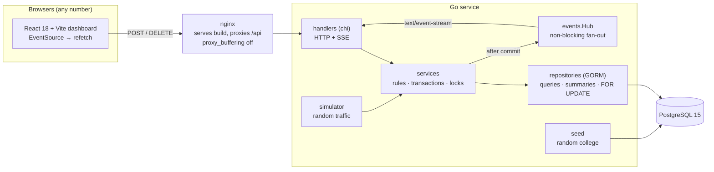
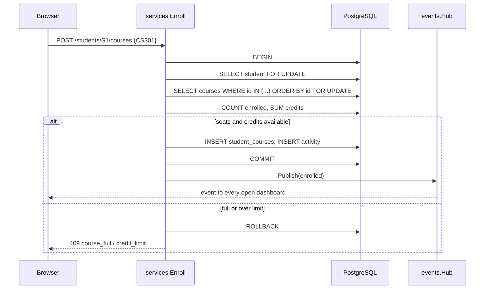
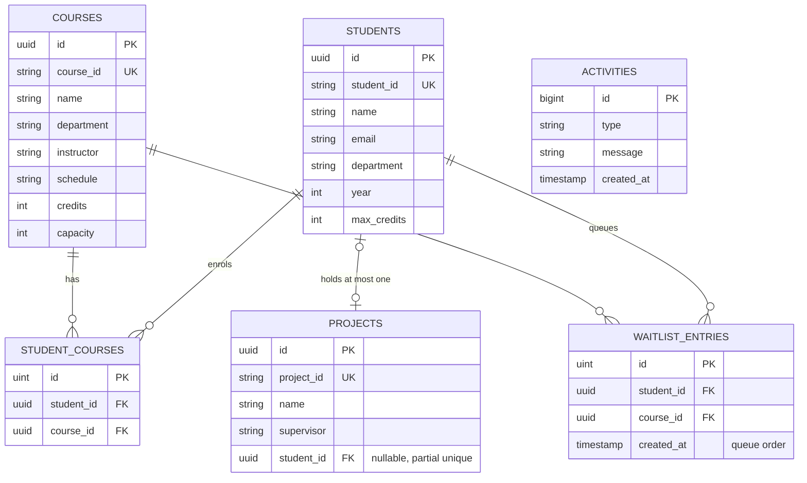

# System architecture

## Components



| Layer | Package | Responsibility |
|---|---|---|
| Entry | `cmd/service` | load config, seed, start server, graceful shutdown |
| Transport | `internal/handlers`, `internal/server` | routes, JSON encoding, error mapping, CORS, SSE stream with heartbeat and `retry` |
| Domain | `internal/services` | every business rule, inside one transaction per request; typed errors (`invalid` 400, `not_found` 404, `conflict` 409) |
| Data | `internal/repositories`, `internal/models`, `internal/db` | read models, row locks, AutoMigrate plus raw-SQL FK and partial indexes |
| Live | `internal/events` | `Subscribe()` returns a 32-buffered channel; `Publish` drops for a slow client instead of blocking writers |
| Demo | `internal/seed`, `internal/simulator` | random data and traffic through the real service rules |
| UI | `web/` | Dashboard, Registration, Courses, Students and Projects pages; a live version counter triggers refetches, and flash highlights mark changes |

## Enrolment: the critical path



Concurrent requests for the same course queue on the course row lock, so each one sees the count left by the one before it. Locks are always taken student first, then courses sorted by id, which rules out lock-order deadlocks.

## Project claim

```sql
UPDATE projects SET student_id = $1
WHERE id = $2 AND student_id IS NULL;   -- 0 rows → 409 project_taken
```

The re-check happens inside the write, so there is no window between reading and writing. A partial unique index on `projects.student_id` (where not null) stops one student holding two projects.

## Data model



### Indexes and why

| Index | Purpose |
|---|---|
| `students.student_id`, `courses.course_id`, `projects.project_id` unique | human-code lookups used by the API |
| `students.name` | `/students/details?name=` |
| `projects.student_id` partial unique `WHERE NOT NULL` | one project per student, still allowing many unassigned projects |
| `student_courses(student_id, course_id)` unique | no duplicate enrolment; single-column indexes back counts and rosters |
| `waitlist_entries(student_id, course_id)` unique, `course_id`, `created_at` | no double queueing; FIFO promotion |
| FK `projects.student_id → students.id ON DELETE SET NULL` | deleting a student frees their project |

## Live updates

- `GET /events` sets `Content-Type: text/event-stream`, `X-Accel-Buffering: no`, sends `retry: 3000` and a heartbeat comment every 15 s.
- Events are published **after commit only**, so a viewer never sees a change that is later rolled back.
- The browser's `EventSource` reconnects automatically. On each event the UI bumps a version counter, and pages refetch their data.
- The hub is in memory, so the service must run as **one instance**. Scaling out needs a shared bus such as PostgreSQL `LISTEN/NOTIFY` (see Future work in the README).
